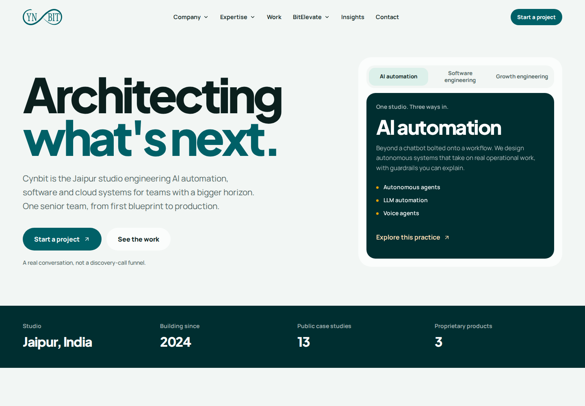

# Cynbit Website Improvement

A secure, cache-aware, content-driven rebuild of Cynbit Technologies' public
website. This repository is the Full Stack Developer Intern assessment
submission: recreate the public site and close the findings from the passive
backend audit.

**Live site:** <https://cynbit-website-improvement.vercel.app>
**Final release:** `v1.0.3`
**Audit repository:** <https://github.com/Anos714/cynbit-passive-audit>



> [!IMPORTANT]
> **The live demo does not send email.** Contact, newsletter and job-application
> forms are fully implemented server-side flows, but the public deployment runs
> without Resend credentials. Submissions are accepted, shown as **Demo mode**
> in the UI, and only a random reference is logged — no message is delivered.
> To enable real delivery, set `RESEND_API_KEY`, `CONTACT_TO_EMAIL` and
> `RESEND_FROM_EMAIL` together (see [Environment variables](#environment-variables)).
> The UI never claims an email was sent when it was not.

---

## Contents

- [Why this rebuild exists](#why-this-rebuild-exists)
- [What is in the rebuild](#what-is-in-the-rebuild)
- [Routes](#routes)
- [Architecture](#architecture)
- [Content and GEO](#content-and-geo)
- [Forms, email and demo mode](#forms-email-and-demo-mode)
- [Security](#security)
- [Accessibility and motion](#accessibility-and-motion)
- [Measured results](#measured-results)
- [Stack](#stack)
- [Local development](#local-development)
- [Environment variables](#environment-variables)
- [Project structure](#project-structure)
- [Verification](#verification)
- [Deployment](#deployment)
- [Known limitations and trade-offs](#known-limitations-and-trade-offs)
- [Documentation](#documentation)
- [License and attribution](#license-and-attribution)

## Why this rebuild exists

The supplied passive audit measured the public site without touching private
surfaces. The rebuild therefore has two jobs:

1. Recreate the public experience route-for-route, including content
   collections, forms, navigation and error states.
2. Resolve the audit findings without inventing data or weakening security.

Every audit finding maps to a change in this repository. The mapping and any
residual risk are recorded in [audit traceability](docs/audit-traceability.md)
rather than left implicit.

## What is in the rebuild

- **82 public URLs** — 16 top-level routes, 25 blog posts, 13 case studies,
  20 roles and 8 student diaries — prerendered and listed in the sitemap.
- **Server-side forms** for contact, newsletter and job applications with Zod
  validation, layered rate limiting, honeypots, timing checks and honest
  delivery states.
- **Explicit cache policy** that matches the rendering model: ISR HTML for five
  minutes with a one-day stale window, immutable hashed assets.
- **Security headers and an enforced CSP** served from `next.config.ts`,
  including a same-origin CORS override and HSTS.
- **Discovery surfaces** for classic and generative search: sitemap, robots,
  canonical URLs, Open Graph, JSON-LD and `/llms.txt`.
- **Responsive UI fixes** verified at the exact breakpoint: the navigation
  dialog works at 768px and hands off to the desktop nav at 1024px, the footer
  reaches the end of the document, and the hero phrase rotates with a static
  fallback under `prefers-reduced-motion`.
- **Browser and accessibility tests** that walk every sitemap URL in a real
  Chromium build, plus axe checks on the 16 top-level pages.

The homepage payload is smaller than the audit baseline, and the measured
Lighthouse and transfer numbers are recorded below with their method.

## Routes

| Group | Count | Examples |
|---|---:|---|
| Top-level pages | 16 | `/`, `/story`, `/team`, `/services`, `/contact` |
| Blog posts | 25 | `/blog/top-web-development-trends-2026` |
| Case studies | 13 | `/case-studies/wizhealth-ai-diagnostic` |
| Careers | 20 | `/careers/ai-engineer` |
| Student diaries | 8 | `/diaries/perfect-timeline-myth` |
| **Total in sitemap** | **82** | |

Machine-readable endpoints outside the sitemap:

- `/sitemap.xml` — generated from the content collections.
- `/robots.txt` — allows public pages, disallows `/api/`.
- `/llms.txt` — a concise, factual guide for generative search engines.
- `/api/health` — lightweight health check.
- `/api/csp-report` — CSP violation report sink.
- `/api/revalidate` — bearer-protected ISR revalidation.

## Architecture

The site uses the Next.js 16 App Router with a clear server/client boundary:

- **Server components** render content, metadata and JSON-LD. Marketing pages
  use `revalidate = 300`; dynamic content uses `generateStaticParams` and
  `dynamicParams = false` so unknown slugs return the branded 404.
- **Client components** are limited to interaction: navigation, dialogs,
  accordions, forms, reveal-on-scroll and the hero rotator. Animation is CSS
  first; Motion is imported only where dialog orchestration needs it.
- **Server actions** own form submission. Validation schemas are shared between
  the client and the server, and delivery status is modelled explicitly.
- **Content collections** live under `src/content/`. Routes, sitemap entries and
  structured data are derived from the same records, so a missing page or
  mismatch is caught by `verify:routes`.
- **Configuration** such as the canonical origin lives in `src/lib/site.ts` and
  is driven by `NEXT_PUBLIC_SITE_URL`.

More detail: [architecture](docs/architecture.md) and
[content model](docs/content-model.md).

## Content and GEO

Generative Engine Optimization (GEO) is treated as a correctness problem, not a
keyword exercise. The rebuild adds:

- `/llms.txt` with a canonical summary, core page links, service list, product
  list and explicit guidance not to infer pricing, clients, certifications or
  coordinates.
- `Organization` + `ProfessionalService` JSON-LD with the studio address,
  `areaServed` (Jaipur, Rajasthan, India), `knowsAbout`, a contact point and
  `sameAs` profiles.
- `WebSite` JSON-LD tied to the organization.
- `FAQPage` JSON-LD generated from the visible contact FAQ — the same questions
  a visitor sees, not a hidden parallel set.
- `Service` JSON-LD generated from the visible service practices and their
  capabilities.
- `BlogPosting`, `JobPosting` and `BreadcrumbList` on the relevant detail pages.
- Canonical URLs, Open Graph/Twitter metadata and `geo.region` / `geo.placename`
  hints for the Jaipur studio.

No coordinates, ratings, prices, client logos or testimonials were invented.
Where the public source did not provide a fact, the schema omits it.

## Forms, email and demo mode

All three forms follow the same pattern:

1. Client-side hints improve the experience; the server validates again with
   Zod. Client validation is never treated as a security boundary.
2. A honeypot and a minimum completion time reject naive automated submissions.
   Submit buttons stay disabled until the client has hydrated, so a very early
   click cannot fall through to a native form post before the Server Action is
   attached.
3. A sliding-window rate limiter runs before delivery. Upstash Redis is used
   when configured; otherwise the documented in-memory fallback applies.
4. The action returns a typed result. Success says **Received** and, when the
   demo transport is active, explicitly says **Demo mode**.
5. Logs contain a random reference only — no message body, email address or IP.

**Delivery is configuration, not code.** With all three of `RESEND_API_KEY`,
`CONTACT_TO_EMAIL` and `RESEND_FROM_EMAIL` set, the Resend transport is used.
Without them, `EMAIL_TRANSPORT` auto-detects to the demo transport. The public
deployment currently uses the demo transport, so no mail leaves the server.

## Security

- Enforced Content Security Policy, HSTS with `includeSubDomains`, frame
  protection, a strict referrer policy and a restrictive permissions policy.
- A same-origin `Access-Control-Allow-Origin` header overrides Vercel's
  wildcard on static output.
- APIs accept only the methods they implement; form actions are rate-limited
  and validated server-side.
- Secrets stay in environment variables. `.env`, `.env.local` and private audit
  material are not committed.
- CSP is intentionally static and includes `'unsafe-inline'`; a nonce would
  force every prerendered page to render per request and undo the caching work.
  This trade-off, and the residual risk, is documented in
  [security](docs/security.md).

## Accessibility and motion

- Semantic landmarks, a skip link, visible focus styles, labelled controls and
  a native `<dialog>` mobile menu.
- axe checks run on all 16 top-level pages in CI and against the live site.
- Decorative motion respects `prefers-reduced-motion`. The hero rotator keeps
  the first phrase statically visible and cancels its interval when reduced
  motion is requested; reveal animations are disabled by the global media
  query. The hero's accessible name stays `Architecting what's next.` while the
  visual phrase rotates.

## Measured results

Local production build (`next start`), Lighthouse 13 with its default
simulated throttling. These are lab numbers from one machine, not field data.

| Page | Form factor | Performance | Accessibility | Best practices | SEO |
|---|---|---:|---:|---:|---:|
| `/` | Mobile | 95 | 100 | 100 | 100 |
| `/` | Desktop | 100 | 100 | 100 | 100 |
| `/careers` | Mobile | 94 | 100 | 100 | 100 |
| `/blog/top-web-development-trends-2026` | Mobile | 97 | 100 | 100 | 100 |

Client payload on the homepage, compared with the audit baseline:

| Group | Before (decoded) | After (decoded) | Before (Brotli) | After (Brotli) |
|---|---:|---:|---:|---:|
| Modern-path JavaScript | 597,497 B | 535,585 B | 186,310 B | 141,352 B |
| CSS | 181,212 B | 55,642 B | 25,695 B | 9,554 B |
| **Total transfer** | — | — | **212,005 B** | **150,906 B** |

That is a 28.8% reduction in compressed JS + CSS transfer. The hero rotator adds
no dependency and no significant client payload; it uses CSS animations around a
small interval. Full method and caveats:
[performance notes](docs/performance.md). Raw Lighthouse HTML/JSON is in
[`docs/evidence/lighthouse/`](docs/evidence/lighthouse/).

### Live verification

Checked against the production deployment on 2026-10-26:

- `scripts/verify-headers.mjs` passes: enforced CSP, HSTS, cache policy,
  same-origin CORS (no wildcard), 82 sitemap URLs, publicly cacheable
  `/llms.txt`, and `no-store` APIs.
- Playwright walks all 82 live URLs: `200`, visible `h1`, no console or CSP
  errors.
- axe finds no serious or critical violations on the 16 top-level live pages.
- The CI workflow (lint, typecheck, unit tests, build, route parity, Playwright)
  is green on `main`.

The Lighthouse table above was measured on a local production build, not
against Vercel; it is labelled accordingly.

## Stack

| Layer | Choice |
|---|---|
| Framework | Next.js 16.4.3 App Router, React 19.3.1, TypeScript strict |
| Styling | Tailwind CSS 4.3.3, self-hosted variable fonts |
| Motion | CSS reveal observer and hero rotator; Motion 14 only for the newsletter dialog |
| Validation | Zod 4.6.7 shared by client hints and server actions |
| Forms | React Server Actions + `useActionState` |
| Rate limiting | Upstash Redis sliding window, documented in-memory fallback |
| Email | Resend when configured, clearly labelled demo transport otherwise |
| Tests | Vitest, Playwright 1.64, `@axe-core/playwright`, Lighthouse 13 |
| Hosting | Vercel (Node 22.19.0) |

## Local development

```bash
nvm use
npm ci
cp .env.example .env.local
npm run dev
```

Open <http://localhost:3000>. With no email or Redis keys the app runs in demo
mode: submissions are accepted, the UI says "Demo mode", and only a random
reference is logged. No message body, email address or IP is logged.

To exercise the exact production output:

```bash
npm run build
npm start -- -p 3100
```

Then open <http://localhost:3100>. Playwright defaults to port 3100 and can
reuse that server.

## Environment variables

| Variable | Required | Purpose |
|---|---|---|
| `NEXT_PUBLIC_SITE_URL` | Production build | Canonical origin, without a trailing slash. Used by metadata, sitemap, JSON-LD and `/llms.txt`. |
| `RESEND_API_KEY` | Real email | Resend API key. |
| `CONTACT_TO_EMAIL` | Real email | Destination mailbox for form submissions. |
| `RESEND_FROM_EMAIL` | Real email | Verified sender, for example `Cynbit Website <website@cynbit.in>`. |
| `EMAIL_TRANSPORT` | No | Leave unset to auto-detect Resend, or force the demo transport. |
| `UPSTASH_REDIS_REST_URL` | Recommended | Upstash REST endpoint for distributed rate limiting. |
| `UPSTASH_REDIS_REST_TOKEN` | Recommended | Upstash REST token; required together with the URL. |
| `REVALIDATE_SECRET` | For ISR API | Bearer secret of at least 32 random characters for `POST /api/revalidate`. |
| `CSP_ENFORCE` | No | Defaults to enforced. Set `false` only while investigating a CSP violation. |

Real email requires **all three** Resend values. A partial configuration falls
back to the demo transport rather than failing a submission.

## Project structure

```text
src/
  app/
    (marketing)/       16 top-level pages and dynamic detail routes
    api/               health, CSP report, revalidation
    llms.txt/          generative-search guide
    sitemap.ts         sitemap derived from content collections
    robots.ts          crawl policy
  components/
    content/           cards and editorial building blocks
    forms/             contact, newsletter, application forms
    home/              hero rotator and capability explorer
    layout/            header, footer, mobile dialog menu
    motion/            reveal-on-scroll wrapper
    seo/               JSON-LD renderer
    ui/                buttons, tags, accordions, page headers
  content/             typed content collections and page copy
  lib/                 site config, SEO helpers, actions, rate limiting, validation
tests/
  e2e/                 route sweep, structured data, interactions, axe
scripts/               header, route, payload and Lighthouse verification
docs/                  architecture, security, performance and evidence
```

## Verification

```bash
npm run lint
npm run typecheck
npm test                 # unit tests
npm run build
npm run verify:routes    # every content entry has a sitemap URL and HTML file
npm run verify:headers   # headers, cache policy, sitemap count, API methods
npm run test:e2e         # 82-route sweep, axe, interactions, schema, llms.txt
npm run lighthouse       # writes docs/evidence/lighthouse/
```

`npm run check` runs lint, typecheck, unit tests, build and route parity. CI
runs the same gate plus the Playwright suite against a production build.

The interaction suite includes regressions for the recent UI work:

- the footer’s bottom edge is within 1px of the document end at 390, 768 and
  1440px;
- the mobile menu opens at exactly 768px and remains available through 1023px;
- the hero shows the first phrase immediately, rotates it, and stays static
  under `prefers-reduced-motion`;
- `/contact` and `/services` expose FAQ and Service JSON-LD, and `/llms.txt`
  returns plain text.

## Deployment

The site is deployed on Vercel from `main`. The recommended setup:

1. Import the repository and keep the default Next.js build settings.
2. Set `NEXT_PUBLIC_SITE_URL` to the production origin.
3. Optionally add the Resend and Upstash values. Without Resend the deployment
   works, but forms stay in demo mode.
4. Add `REVALIDATE_SECRET` if you intend to call the revalidation API.
5. After deployment, run `node scripts/verify-headers.mjs https://your-origin`
   and the read-only live Playwright route/axe sweep:
   `PLAYWRIGHT_BASE_URL=https://your-origin npx playwright test tests/e2e/routes.spec.ts`.

Environment and post-deploy checks are documented in
[deployment](docs/deployment.md).

## Known limitations and trade-offs

- **Email is in demo mode unless keys are provided.** This is the most
  important operational limitation. The contact, newsletter and application
  forms are real server-side flows, but without a Resend key they do not deliver
  mail. The UI never claims otherwise. Configure `RESEND_API_KEY`,
  `CONTACT_TO_EMAIL` and `RESEND_FROM_EMAIL` together to enable delivery.
- **The in-memory rate limiter is per instance.** Upstash is the production
  path; the fallback is best-effort and resets on deploy.
- **CSP is enforced with `'unsafe-inline'` and no nonce.** A nonce would force
  prerendered pages to render per request and undo the cache fix. This is a
  deliberate trade-off, documented in the security notes.
- **HSTS preload is not enabled.** `includeSubDomains` is set, but submitting to
  the preload list is a long-lived commitment that needs a subdomain inventory
  and a custom domain under Cynbit's control.
- **The live origin is a Vercel preview domain.** Canonical URLs use that origin
  until `NEXT_PUBLIC_SITE_URL` is pointed at a Cynbit-controlled domain.
- **No fabricated content.** Copy, dates and metrics come from the public site
  and the supplied audit. No testimonials, client results, ratings or scores were
  invented. Structured data omits facts the source did not establish. The
  `JobPosting` posting/expiry dates are explicit operational review constants,
  not claims about the original site; they are documented in the
  [content model](docs/content-model.md).

## Documentation

- [Technical report](docs/technical-report.md) — problem, decisions, results
- [Architecture](docs/architecture.md) — rendering, data flow, components
- [Security](docs/security.md) — headers, CSP, form abuse controls, residuals
- [Performance](docs/performance.md) — payload, caching, Lighthouse method
- [Audit traceability](docs/audit-traceability.md) — finding-by-finding mapping
- [Content model](docs/content-model.md) — collections, dates, sitemap rules
- [Deployment](docs/deployment.md) — Vercel, environment, post-deploy checks

## License and attribution

Site copy and brand assets belong to Cynbit Technologies. Third-party licences
are listed in [THIRD_PARTY_NOTICES.md](THIRD_PARTY_NOTICES.md). The bundled
Manrope and Plus Jakarta Sans fonts are used under the SIL Open Font License;
their licence files live next to the font files.
